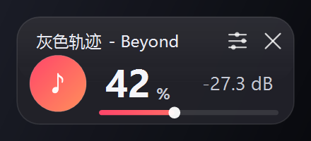
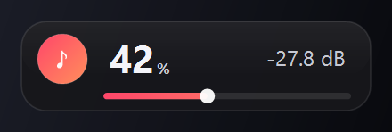
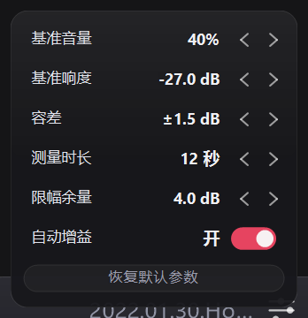

# LevelBand

> 让每首歌都落在你能接受的响度带里 —— 而不是把所有声音拉平。

A tiny always-on-top HUD that keeps **one app's audio** (Netease Cloud Music by default) inside a loudness band you define — per song, with memory.



---

## 中文

### 为什么做这个

我的网易云云盘里有 1000 多首 MP3：

- 官方发行的歌，响度正常
- 从视频转出来的 MP3，普遍偏小
- 而有些现代母带，响度又明显偏大

结果是**每切一首歌都要手动拖一次音量**。系统自带的"响度均衡"会把所有声音压平，动态全没了；音量合成器只能手动调，记不住歌。

所以我做了这个：**只调一个程序、按歌记住、落在区间内就不动。**

### 它做什么

| 做 | 不做 |
|---|---|
| 只改网易云那一条音频会话的音量 | 不动系统音量、不动游戏音量 |
| 按歌记录"这首歌本身有多响"，下次直接到位 | 不做均衡/EQ，不改音质 |
| 把响度维持在**目标区间**内（可升可降） | 不会把所有歌压成一样响 |
| 局部爆音用限幅器临时压一下 | 不注入进程、不装驱动、不联网 |
| 记不住的时候自己学 | 不需要管理员权限 |

### 截图

| 常态 | 悬停展开 |
|---|---|
|  |  |

| 参数面板 |
|---|
|  |

### 工作原理

```
            容差 ±1.5 dB         容差 ±1.5 dB
   ────────────┬─────────────────────┬──────────
            −28.5                  −27                 −25.5
               ← 太安静：升 →    │    ← 太响：降 →
                               中心（最舒适）
```

**1. 目标区间**
中心 = 「基准响度」，区间 = 中心 ± 「容差」。落在区间内**完全不动**，避免一直微调。

**2. 学习器（主力）**

- 每 100ms 采样一次 RMS，低于 −60 dBFS 的样本直接丢弃
- 归一化成「源响度」= 样本 dB − 20·log10(当前推子)，与当前音量无关
- 取**近 45 秒的 P80 分位**，不会被长安静段骗
- 首次定档：攒够「测量时长 × 10」个样本后一次到位
- 之后：每 6 秒复检一次，出区间就调，**每次最多 1 dB**，可升可降
- 上限：永远不超过「基准音量」

**3. 限幅器（只管局部爆音）**

1.2 秒的平均电平超过「基准 + 限幅余量 + 1 dB」时压到门限，保持 3 秒，之后每秒放开 1.5 dB，单次最多 −12 dB。不写缓存。

**4. 限幅反馈（一次性粗调）**

30 秒内累计 3 次独立限幅，说明这首歌被估低了 → 修正源响度一次，写回缓存。每首歌只允许一次。

**5. 按歌缓存**

`songs.ini` 每行 `源响度|歌名`。因为存的是「这首歌本身多响」，**改任何参数都不需要重新学习**。

### 安装 / 运行

1. 从 Releases 下载 `LevelBand.exe`
2. 双击运行（不需要安装）
3. 网易云开始播放后，小条会自动绑定它的音频会话

要求：Windows 10/11 x64（.NET Framework 4.8 系统自带）

### 操作

| 操作 | 作用 |
|---|---|
| 拖左侧音符圆 / 右键拖任意处 | 移动窗口 |
| 左键点击条子 / 拖动条子 | 调音量 |
| **Ctrl + ↑ / ↓** | ±2%（仅鼠标停在小窗上时生效） |
| 中键 | 静音切换 |
| 左键点右侧菜单图标 | 参数面板 |
| 右键点右侧菜单图标 | 快捷菜单 |
| 悬停后点 × | 退出 |

### 参数

| 参数 | 默认 | 范围 | 说明 |
|---|---|---|---|
| 基准音量 | 40% | 25~70% | 硬上限，也是安静歌的实际音量 |
| 基准响度 | −26 dB | −30~−14 | 区间中心；越小越安静 |
| 容差 | ±1.5 dB | ±0.5~±4 | 越大越少动 |
| 测量时长 | 12 秒 | 4~12 秒 | 首次定档前的采样时长 |
| 限幅余量 | 4 dB | 2~8 dB | 门限 = 基准响度 + 它 |

> 经验：**限幅余量应比容差大 2~3 dB**，否则限幅器会落进区间内部，导致持续压制。

### 数据文件

```
%APPDATA%\LevelBand\
    config.ini    参数、窗口位置
    log.txt       运行日志（启动清空；单次运行超 1 MB 自动清空）
    songs.ini     按歌缓存
```

删掉 `songs.ini` 即可清空所有学习结果。

### 自己编译

``` powershell
.\build.ps1          # 编译到 dist\LevelBand.exe
.\build.ps1 -Run     # 编译并运行
```

只需要 Windows 自带的 `csc.exe`（.NET Framework 4.x），没有任何第三方依赖。

### 已知限制

| 限制 | 原因 |
|---|---|
| 盖不住**独占全屏**游戏 | Windows 限制，只有注入能破 |
| 音量不能超过 100% | 会话推子物理上限 |
| 目前只支持网易云 | 进程名写死为 `cloudmusic.exe`（想换播放器改 `Program.cs` 里的 `ProccessName`） |
| 响度是 RMS 的 P80，不是标准 LUFS | 同一读数下「响」和「吵」不完全等价 |
| 无签名 exe | 可能被杀软提示，可自行编译 |

### 隐私

- **不联网**：源码里没有任何网络 API
- **不保存音频**：只把每 100ms 的响度算成一个浮点数，PCM 数据算完即弃
- **只写自己的三个文件**，外加开机自启时写一条 HKCU 注册表（需手动开启）

### 免责

本项目与网易公司无关，未获官方授权。它只调用 Windows 官方的 WASAPI 接口调整**本机**指定程序的音会话量，不修改、不注入、不逆向任何客户端。

---

## English

A tiny HUD that keeps **one app's audio** inside a loudness band you define — per song, with memory.

### Why

Most of my library is MP3s ripped from video, so they are far quieter than official releases, while some modern masters are much louder. Every song change meant dragging the volume slider again. Windows' built-in "loudness equalization" flattens everything and destroys dynamics; the volume mixer has no memory.

LevelBand fixes exactly that: **one app, per-song memory, and no action at all while the level stays inside the band.**

### How it works

1. **Target band** — center = target loudness, half-width = tolerance. Inside the band nothing happens.
2. **Learner** — 100 ms RMS samples (below −60 dBFS dropped), normalized to a volume-independent "source loudness", aggregated as the **P80 of the last 45 s**. First commit after the configured measurement duration; afterwards it re-checks every 6 s and moves **at most 1 dB per step**, in both directions.
3. **Limiter** — a 1.2 s average level above `target + margin` is pulled down to the threshold, held for 3 s, released at 1.5 dB/s, capped at −12 dB. Never cached.
4. **One-shot feedback** — three independent limiter hits within 30 s mean the estimate was too low; the cached source loudness is corrected once per song.
5. **Per-song cache** — `source loudness|title`. Since it stores how loud the *song* is, changing parameters never requires re-learning.

### Run

Download `LevelBand.exe` from Releases and double-click. Requires Windows 10/11 x64 with .NET Framework 4.8 (preinstalled). The window is always-on-top but only re-asserts itself every 15 seconds, so full-screen screen-capture tools (WeChat/QQ) are not disturbed.

Controls: drag to move, click/drag the bar to set volume, **Ctrl + ↑/↓** while hovering for ±2%, middle-click to mute, left-click the menu icon for settings, right-click it for the quick menu. Long track titles scroll slowly while you hover.

### Build

``` powershell
.\build.ps1
```

Only needs the `csc.exe` shipped with .NET Framework 4.x. No third-party dependencies.

### Notes & limitations

- Currently hardcoded to Netease Cloud Music (`cloudmusic.exe`); change `ProccessName` in `Program.cs` for other players.
- Cannot draw over exclusive-fullscreen games.
- Loudness is RMS P80, not BS.1770 LUFS.
- Unsigned binary — some antivirus tools may warn. Build it yourself if you prefer.

### Privacy

No network code, no audio is stored (only one float per 100 ms for the level estimate), and the only files written are `config.ini`, `log.txt`, `songs.ini` under `%APPDATA%\LevelBand`.

### Disclaimer

Not affiliated with NetEase. Uses only the public WASAPI session APIs on the local machine; no injection, no patching, no reverse engineering.

---

## License

MIT — see [LICENSE](LICENSE).
