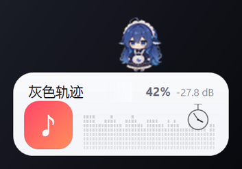
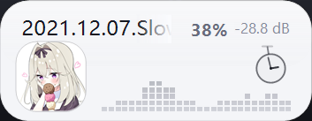

# LevelBand

> 让每首歌都落在你能接受的响度带里 —— 而不是把所有声音拉平。

A tiny always-on-top HUD that keeps **one app's audio** (Netease Cloud Music by default) inside a loudness band you define — per song, with memory.



---

## 中文

### 两个版本

| | `LevelBand.exe`（完整版） | `LevelBand-lite.exe`（轻量版） |
|---|---|---|
| 体积 | 436 KB | **282 KB** |
| 窗口 | 196 × 130 | **196 × 76** |
| 顶边小人 | 有（31 帧 / 6 个动作） | 完全没有 |
| 挂钟 / 频谱 / 歌名滚动 / 深浅主题 | 有 | 有 |
| 音量与 dB 显示 | 有 | 有 |

两版功能完全一致，只差顶部那个装饰用的角色。轻量版省下的 154 KB 全部是那张精灵图。

| 完整版 | 轻量版 |
|---|---|
|  |  |

### 为什么做这个

我的网易云云盘里有 1000 多首 MP3：

- 官方发行的歌，响度正常
- 从视频转出来的 MP3，普遍偏小
- 而有些现代母带，响度又明显偏大

结果是**每切一首歌都要手动拖一次音量**。系统自带的"响度均衡"会把所有声音压平，动态全没了；音量合成器只能手动调，记不住歌。

所以我做了这个：**只调一个程序、按歌记住、落在区间内就不动。**

### 它做什么

| 做 | 不做 |
|---|---|
| 只改网易云那一条音频会话的音量 | 不动系统音量、不动游戏音量 |
| 按歌记录"这首歌本身有多响"，下次直接到位 | 不做均衡/EQ，不改音质 |
| 把响度维持在**目标区间**内（可升可降） | 不会把所有歌压成一样响 |
| 局部爆音用限幅器临时压一下 | 不注入进程、不装驱动、不联网 |
| 记不住的时候自己学 | 不需要管理员权限 |

### 工作原理

```
            容差 ±1.5 dB         容差 ±1.5 dB
   ────────────┬─────────────────────┬──────────
            −28.5                  −27                 −25.5
               ← 太安静：升 →    │    ← 太响：降 →
                               中心（最舒适）
```

**1. 目标区间**
中心 = 「基准响度」，区间 = 中心 ± 「容差」。落在区间内**完全不动**，避免一直微调。

**2. 学习器（主力）**

- 每 100ms 采样一次 RMS，低于 −60 dBFS 的样本直接丢弃
- 归一化成「源响度」= 样本 dB − 20·log10(当前推子)，与当前音量无关
- 取**近 45 秒的 P80 分位**，不会被长安静段骗
- 首次定档：攒够「测量时长 × 10」个样本后一次到位
- 之后：每 6 秒复检一次，出区间就调，**每次最多 1 dB**，可升可降
- 上限：永远不超过「基准音量」

**3. 限幅器（只管局部爆音）**

1.2 秒的平均电平超过「基准 + 限幅余量 + 1 dB」时压到门限，保持 3 秒，之后每秒放开 1.5 dB，单次最多 −12 dB。不写缓存。

**4. 限幅反馈（一次性粗调）**

30 秒内累计 3 次独立限幅，说明这首歌被估低了 → 修正源响度一次，写回缓存。每首歌只允许一次。

**5. 按歌缓存**

`songs.ini` 每行 `源响度|歌名`。因为存的是「这首歌本身多响」，**改任何参数都不需要重新学习**。

### 界面与装饰

- **常驻歌名**：长标题一直慢速滚动，右端渐隐，不会硬切
- **音量数字 + dB**：跟着频谱一起显示，不遮挡
- **频谱**：方格或连续柱两种样式，可调浓度
- **挂钟**：频谱区右上方，18px，会左右摆动，指针走真实时间
- **深浅主题**：一次切换整窗配色
- **顶边小人**（仅完整版）：站在卡片上边缘，安静时随机哼歌 / 打哈欠 / 打盹 / 被吓一跳（切歌触发），会自己走到别的位置，转身时镜像

### 安装 / 运行

1. 从 [Releases](../../releases) 或 `dist/` 下载 `LevelBand.exe`（或 `LevelBand-lite.exe`）
2. 双击运行（不需要安装）
3. 网易云开始播放后，小条会自动绑定它的音频会话

要求：Windows 10/11 x64（.NET Framework 4.8 系统自带）

> **首次运行会被 Windows 拦一次，这是正常现象。**
>
> exe **没有购买代码签名证书**。SmartScreen 对来源不明、下载量少的程序一律先拦一次，跟程序本身是否安全无关。点「更多信息」→ 右下角出现「仍要运行」→ 点它即可，同名的 exe 以后不再提示。
>
> 如果被 Defender 或杀软隔离：本程序通过 WASAPI 调整其它程序的音量，行为上有"操作别的程序"的特征，偶尔会被启发式规则误判。把它加入排除项，或者用 `build.cmd` 自己编一份——你编译出来的文件在你机器上是干净的。
>
> **为什么发布版不带签名**：自签名证书在别人的机器上验证不过，只会把提示从「未知发布者」变成「签名无效」，反而更让人不敢运行。所以 `dist/` 和 Releases 里的 exe 是无签名裸 exe。
>
> 详细版说明见 Release 附件 `FIRST-RUN.txt`。

#### 不想手动点？让 AI 一句话搞定

拦截其实有三种，现象不同，处理方式也不同：

| 你看到的现象 | 谁拦的 | 手动怎么处理 |
|---|---|---|
| 浏览器提示「不常下载，可能不安全」 | Edge / Chrome 的下载保护 | 点「保留」/「仍然保留」 |
| 双击后弹「Windows 已保护你的电脑」 | SmartScreen，依据文件的「来自网络」标记 | 更多信息 → 仍要运行 |
| 文件莫名消失，或者 Defender 报毒 | 杀毒软件的启发式规则 | 从隔离区还原，再加排除项 |

这三种里前两种都能靠**去掉「来自网络」标记**（`Zone.Identifier` 数据流）一次性解决——标记一去，SmartScreen 就不会再把文件送去信誉查询。这活儿打字比点鼠标快，所以交给 AI 最省事。

把下面整段复制给你在用的 AI 助手（WorkBuddy、Claude Code、Cursor 之类能操作本机的都行），**只需要改第一行的路径**：

```text
我刚从 GitHub 下载了开源的 LevelBand.exe（网易云音量小挂件），Windows 提示
「Windows 已保护你的电脑」，打不开。

文件完整路径是：C:\Users\你的用户名\Downloads\LevelBand.exe
（如果不是这里，改成你实际存放的位置）

按顺序帮我处理，做完一步报一步的结果，不要跳步：

1. 先只读、不改任何东西：报告文件大小、SHA256、以及是否带「来自网络」标记
   （Zone.Identifier 数据流）。完整版预期 436.5 KB，轻量版 282.5 KB。
2. 不要删除、不要重命名、不要移动到别的目录。用 Unblock-File 去掉「来自网络」标记。
3. 如果 Windows Defender 已经把它隔离或删除了，从「保护历史记录」里还原，再重做第 2 步。
4. 处理完告诉我怎么双击运行。如果还提示，把这个 exe 所在目录加进 Defender 排除项，
   并告诉我加了哪个目录（方便我以后撤回）。
5. 最后复核：文件还在原路径、大小没变、SHA256 与第 1 步一致（说明没有被改动过）。

如果以上都不行，或者你觉得更稳妥的做法是自己编译，就走这条路：
从这个仓库本地编译——https://github.com/LJK-sss/netease-volume-hud
用仓库根目录的 build.cmd（不是 build.ps1；双击 bat 才能绕开 PowerShell 执行策略），
产物在 dist\ 里。自己编译的文件没有「来自网络」标记，不会有任何提示。
编译只需要 .NET Framework 4.x，Win10/11 系统自带。
```

这条提示词之所以能「一句搞定」，是因为它把依赖顺序排好了：先只读核对 → 再去标记 → 再补处理已隔离的情况 → 最后复核哈希。AI 从头跑到尾，中间不需要你回答任何技术问题。第 2 步特意强调了「不删不改名」，避免 AI 为了"解决"问题直接调用删除。

> **有一个例外会让去标记彻底失效**：Windows 11 如果开着**智能应用控制**（Smart App Control，在「Windows 安全中心 → 应用和浏览器控制」里），它会拦下所有无签名的陌生程序，跟「来自网络」标记无关，`Unblock-File` 也没用。
>
> 遇到这种情况只有两条路：关掉它，或者自己编译。**注意关掉之后没法再打开**，除非重装系统或重置 Windows——所以更推荐自己编译。

**自己编译是最彻底的办法。** 区别在于：去标记是「让 Windows 别管这个文件」，自己编译是「这个文件从来没被下载过」。前者一分钟，后者一劳永逸。

**核对哈希**（确认下载完整、没被篡改；用 `certutil -hashfile <文件名> SHA256` 或 PowerShell 的 `Get-FileHash`）。下面是 v0.2.0 附件的值，重新编译出来的会不一样：

```text
LevelBand.exe       657b21fd72dcd0bcf42609398f6672fbfce1c56ab3fcce7f6fc34baf9c59bb25
LevelBand-lite.exe  d0d5dfedd17f64e7fb53b6eb628c5fc11f4171b01a496252456e6b1ece731369
```

### 操作

| 操作 | 作用 |
|---|---|
| 拖左侧音符圆 / 右键拖任意处 | 移动窗口 |
| 左键点击/拖动**底部音量条** | 调音量（只有这一条能调） |
| **Ctrl + ↑ / ↓** | ±2%（仅鼠标停在小窗上时生效） |
| 中键 | 静音切换 |
| 左键点右侧菜单图标 | 参数面板 |
| 右键点右侧菜单图标 | 快捷菜单 |
| 悬停后点 × | 退出 |

### 参数

| 参数 | 默认 | 范围 | 说明 |
|---|---|---|---|
| 基准音量 | 40% | 25~70% | 硬上限，也是安静歌的实际音量 |
| 基准响度 | −26 dB | −30~−14 | 区间中心；越小越安静 |
| 容差 | ±1.5 dB | ±0.5~±4 | 越大越少动 |
| 测量时长 | 12 秒 | 4~12 秒 | 首次定档前的采样时长 |
| 限幅余量 | 4 dB | 2~8 dB | 门限 = 基准响度 + 它 |

> 经验：**限幅余量应比容差大 2~3 dB**，否则限幅器会落进区间内部，导致持续压制。

界面相关的几项在 `%APPDATA%\LevelBand\config.ini` 里：`theme`（0 深色 / 1 浅色）、`spectrum`（频谱浓度 0~50）、`spectrumGrid`（1 方格 / 0 连续柱）、`scale`（缩放）、`opacity`（不透明度）。

### 数据文件

```
%APPDATA%\LevelBand\
    config.ini    参数、窗口位置
    log.txt       运行日志（启动清空；单次运行超 1 MB 自动清空）
    songs.ini     按歌缓存
artwork\          头像图（放在 exe 同级目录，按修改时间轮播）
```

删掉 `songs.ini` 即可清空所有学习结果。

### 自己编译

``` powershell
.\build.ps1            # 完整版 -> dist\LevelBand.exe
.\build.ps1 -Lite      # 轻量版 -> dist\LevelBand-lite.exe
.\build.ps1 -All       # 两个都编
.\build.ps1 -Run       # 编译完直接运行
```

只需要 Windows 自带的 `csc.exe`（.NET Framework 4.x），没有任何第三方依赖。

两种版本用同一份源码：轻量版通过 `-Lite` 排除 `WhaleSprite.cs` 并定义 `NOWHALE` 宏，窗口高度自动退回 196×76。

### 已知限制

| 限制 | 原因 |
|---|---|
| 盖不住**独占全屏**游戏 | Windows 限制，只有注入能破 |
| 音量不能超过 100% | 会话推子物理上限 |
| 目前只支持网易云 | 进程名写死为 `cloudmusic.exe`（想换播放器改 `Program.cs` 里的 `ProccessName`） |
| 响度是 RMS 的 P80，不是标准 LUFS | 同一读数下「响」和「吵」不完全等价 |
| 无代码签名 | 首次运行会被 SmartScreen 拦一次，见上文「安装 / 运行」 |

### 隐私

- **不联网**：源码里没有任何网络 API
- **不保存音频**：只把每 100ms 的响度算成一个浮点数，PCM 数据算完即弃
- **只写自己的三个文件**，外加开机自启时写一条 HKCU 注册表（需手动开启）

### 免责

本项目与网易公司无关，未获官方授权。它只调用 Windows 官方的 WASAPI 接口调整**本机**指定程序的音频会话音量，不修改、不注入、不逆向任何客户端。

---

## English

A tiny HUD that keeps **one app's audio** inside a loudness band you define — per song, with memory.

### Two builds

`LevelBand.exe` (436 KB, 196×130) carries a small animated character sitting on the card's top edge; `LevelBand-lite.exe` (282 KB, 196×76) is exactly the same HUD without it. Everything else — clock, spectrum, marquee title, light/dark themes, loudness display — is identical.

### Why

Most of my library is MP3s ripped from video, so they are far quieter than official releases, while some modern masters are much louder. Every song change meant dragging the volume slider again. Windows' built-in "loudness equalization" flattens everything and destroys dynamics; the volume mixer has no memory.

LevelBand fixes exactly that: **one app, per-song memory, and no action at all while the level stays inside the band.**

### How it works

1. **Target band** — center = target loudness, half-width = tolerance. Inside the band nothing happens.
2. **Learner** — 100 ms RMS samples (below −60 dBFS dropped), normalized to a volume-independent "source loudness", aggregated as the **P80 of the last 45 s**. First commit after the configured measurement duration; afterwards it re-checks every 6 s and moves **at most 1 dB per step**, in both directions.
3. **Limiter** — a 1.2 s average level above `target + margin` is pulled down to the threshold, held for 3 s, released at 1.5 dB/s, capped at −12 dB. Never cached.
4. **One-shot feedback** — three independent limiter hits within 30 s mean the estimate was too low; the cached source loudness is corrected once per song.
5. **Per-song cache** — `source loudness|title`. Since it stores how loud the *song* is, changing parameters never requires re-learning.

### Run

Download `LevelBand.exe` from `dist/` or Releases and double-click. Requires Windows 10/11 x64 with .NET Framework 4.8 (preinstalled). The window is always-on-top but only re-asserts itself every 15 seconds, so full-screen screen-capture tools (WeChat/QQ) are not disturbed.

Controls: drag to move, click/drag only the bottom bar strip to set volume, **Ctrl + ↑/↓** while hovering for ±2%, middle-click to mute, left-click the menu icon for settings, right-click it for the quick menu. Long track titles scroll slowly, all the time.

#### Blocked by Windows? Let an AI fix it

There are three different blocks, and the first two share one root cause: Windows stamps a downloaded file with a `Zone.Identifier` stream ("came from the internet"), and SmartScreen uses that stamp to decide whether to look the file up in its reputation database. Remove the stamp and the prompt stops appearing — which is exactly the kind of thing an agent can do faster than you can click.

Paste the block below into any local AI assistant (WorkBuddy, Claude Code, Cursor, …) and **only change the path on the first line**:

```text
I just downloaded the open-source LevelBand.exe (a volume widget for Netease Cloud
Music) from GitHub, and Windows shows "Windows protected your PC" so it won't start.

The full path is: C:\Users\YourName\Downloads\LevelBand.exe
(change this if you saved it somewhere else)

Work through this in order, reporting the result of each step before moving on:

1. Read-only first, change nothing: report the file size, its SHA256, and whether it
   carries the "from the internet" mark (Zone.Identifier stream).
   Expected size: 436.5 KB full build, 282.5 KB lite build.
2. Do not delete it, rename it, or move it to another folder. Strip the internet mark
   with Unblock-File.
3. If Windows Defender already quarantined or removed it, restore it from Protection
   History, then redo step 2.
4. Tell me how to launch it. If it still gets blocked, add its folder to the Defender
   exclusions and tell me which folder you added, so I can undo it later.
5. Verify at the end: the file is still at the original path, its size is unchanged,
   and its SHA256 matches step 1 (so nothing was modified).

If none of that works, or you think building from source is safer, do this instead:
build it locally from https://github.com/LJK-sss/netease-volume-hud
Use build.cmd in the repository root (not build.ps1 — the .bat wrapper is what gets
past the PowerShell execution policy). Output lands in dist\. A locally built binary
never had the internet mark, so nothing prompts. Only needs .NET Framework 4.x,
which ships with Windows 10/11.
```

The prompt works in one shot because the steps are ordered by dependency: read-only check → strip the mark → handle an already-quarantined file → re-verify the hash. Step 2 spells out "don't delete, don't rename" so the agent doesn't "solve" the problem by deleting your file.

> **One exception defeats the unblock entirely**: Windows 11 with **Smart App Control** enabled (Windows Security → App & browser control) blocks every unsigned, unknown binary regardless of the internet mark — `Unblock-File` will not help. Your only options there are turning it off, or building from source. Note that **Smart App Control cannot be re-enabled** without reinstalling or resetting Windows, so building from source is the better answer.

Building from source is the permanent fix — the difference being that stripping the mark asks Windows to ignore the file, while building locally means the file was never downloaded in the first place.

Verify the download with `Get-FileHash <file> -Algorithm SHA256` (`certutil -hashfile <file> SHA256` also works). These are the v0.2.0 assets; a rebuild will produce different values:

```text
LevelBand.exe       657b21fd72dcd0bcf42609398f6672fbfce1c56ab3fcce7f6fc34baf9c59bb25
LevelBand-lite.exe  d0d5dfedd17f64e7fb53b6eb628c5fc11f4171b01a496252456e6b1ece731369
```

### Build

``` powershell
.\build.ps1            # full build  -> dist\LevelBand.exe
.\build.ps1 -Lite      # lite build  -> dist\LevelBand-lite.exe
.\build.ps1 -All       # both
```

Only needs the `csc.exe` shipped with .NET Framework 4.x. No third-party dependencies. The lite build simply excludes `WhaleSprite.cs` and defines `NOWHALE`.

### Notes & limitations

- Currently hardcoded to Netease Cloud Music (`cloudmusic.exe`); change `ProccessName` in `Program.cs` for other players.
- Cannot draw over exclusive-fullscreen games.
- Loudness is RMS P80, not BS.1770 LUFS.
- **Not code-signed** — SmartScreen blocks it once on first run. Click "More info → Run anyway", or build it yourself. See `FIRST-RUN.txt` in the release assets.

### Privacy

No network code, no audio is stored (only one float per 100 ms for the level estimate), and the only files written are `config.ini`, `log.txt`, `songs.ini` under `%APPDATA%\LevelBand`.

### Disclaimer

Not affiliated with NetEase. Uses only the public WASAPI session APIs on the local machine; no injection, no patching, no reverse engineering.

---

## 授权 / License

**代码**：MIT — see [LICENSE](LICENSE).

**顶边小人（大肥鱼）的素材**：来自开源桌宠项目 [PC2005-cloud/dsh-pet](https://github.com/PC2005-cloud/dsh-pet) 的原始动画，按 **CC BY-NC-SA 4.0** 使用：

- **署名**：DeepSeek「大肥鱼」（鲸鱼娘）为社区二创形象，**非 DeepSeek 官方形象**。原型「溟月」出自 B 站 [@上善无形]，DeepSeek 版（女仆鲸鱼娘）设计出自 B 站 [@ZipZipPipe]。
- **非商业**：不得用于任何形式的商业化。
- **相同方式共享**：基于该形象的二创需以相同协议发布。

**只想要代码、不想要这个形象**：直接用 `-Lite` 编译，或下载 `LevelBand-lite.exe` —— 轻量版二进制里完全不含该素材。
